# Consultas SRI y ANT

Proyecto académico desarrollado para la asignatura **Diseño y Arquitectura de Software**. La aplicación permite consultar información de contribuyentes y vehículos mediante los servicios del Servicio de Rentas Internas (SRI) del Ecuador. También se investigó la posibilidad de consultar los puntos de la licencia de conducir mediante la Agencia Nacional de Tránsito (ANT).

El trabajo se centró en construir una aplicación web funcional, separar las responsabilidades del frontend y del backend, integrar los servicios SRI y documentar qué ocurre cuando un proveedor externo no responde. Durante la integración con ANT encontramos respuestas HTTP 502 que impidieron verificar una consulta real de puntos. Por eso el proyecto distingue claramente entre las funciones implementadas, las pruebas con servicios simulados y las integraciones que todavía no se pueden completar.

**Estado actual:** las consultas de contribuyentes y vehículos SRI están implementadas. La consulta automática de puntos ANT sigue pendiente. Existe una demostración local aislada para probar el contrato, los estados de error y la recuperación desde Redis, pero sus resultados son sintéticos y no son información oficial.

- **Repositorio:** [Juliomm8/Consultas-SRI-ANT](https://github.com/Juliomm8/Consultas-SRI-ANT)
- **Arquitectura C4 en IcePanel:** [Abrir los diagramas del proyecto](https://s.icepanel.io/n43YWpkfdsi2st/hsOQ)
- **Contrato de la API:** [docs/api/contrato-v1.md](docs/api/contrato-v1.md)
- **Diagnóstico de integraciones:** [docs/integraciones/diagnostico-endpoints.md](docs/integraciones/diagnostico-endpoints.md)

---

## 1. ¿Qué problema buscamos resolver?

La actividad plantea desarrollar una aplicación que reúna consultas relacionadas con un contribuyente, un vehículo y los puntos de una licencia de conducir. En lugar de hacer que el navegador se comunique directamente con cada institución, construimos un backend propio que centraliza las solicitudes, valida los datos y organiza las respuestas.

El sistema tiene dos objetivos principales:

1. **Resolver las consultas que sí pudimos integrar:** comprobar la existencia de un RUC, obtener la información del contribuyente y consultar los datos de un vehículo mediante su placa.
2. **Preparar la consulta de puntos ANT sin inventar resultados:** investigar el servicio propuesto, comprobar su disponibilidad y diseñar una solución que pueda incorporar esa integración cuando exista una respuesta funcional y un mecanismo de acceso autorizado.

Esta distinción es importante para entender el resultado. La aplicación no presenta como terminada una conexión que no pudimos verificar. Cuando la consulta ANT no está disponible, el usuario puede acceder al trámite oficial de información del conductor, mientras que las pruebas de desarrollo utilizan un simulador claramente identificado.

## 2. ¿Qué desarrollamos?

### Aplicación web

Construimos una interfaz con React, TypeScript y Vite. Desde ella, el usuario puede ingresar el correo y el RUC para consultar la información del contribuyente. Si la respuesta confirma que corresponde a una persona natural, se habilita la consulta del vehículo mediante la placa.

La interfaz presenta los resultados y los mensajes de error de forma controlada. No se comunica directamente con los servicios del SRI o de la ANT: todas las consultas pasan por nuestra API.

**Portada de escritorio.** Esta captura de Playwright muestra la página de inicio, el catálogo y el inicio del flujo; el formulario está vacío y la imagen no representa una consulta personal.

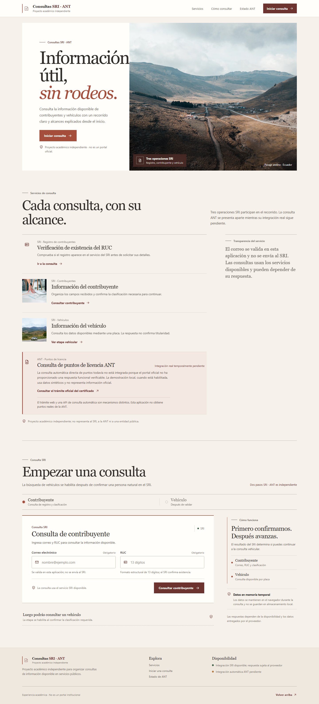

**Vista móvil.** La captura vertical corresponde al recorrido responsive probado con el mismo conjunto local de pruebas.

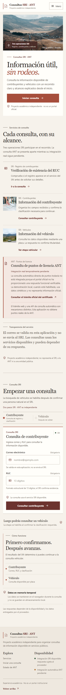

### Backend y servicios SRI

Desarrollamos una API REST con Java 17 y Spring Boot 3.5.16. El backend recibe las solicitudes del frontend, valida sus datos y ejecuta los casos de uso correspondientes.

Para el SRI implementamos adaptadores HTTP que consultan la existencia y los detalles del contribuyente, además de la información del vehículo. También normalizamos las respuestas que recibimos, porque durante las pruebas encontramos diferencias entre las estructuras JSON devueltas por el proveedor.

### Manejo de errores y resiliencia

No todas las respuestas de un servicio externo significan que el dato solicitado no existe. Por ejemplo, un timeout, un error HTTP o una respuesta con una estructura inesperada no deben convertirse en un resultado vacío ni en cero puntos.

Por eso incorporamos un manejo centralizado de errores con códigos, mensajes y un identificador de solicitud (**requestId**). Para el caso de puntos se preparó además un servicio con Circuit Breaker y un puerto de caché. Su comportamiento se puede probar en el entorno local sin depender de que la ANT responda.

### Caché Redis

Implementamos un adaptador con Spring Data Redis para guardar y recuperar el último resultado válido de puntos. La caché está desactivada por defecto. Probamos su funcionamiento contra Redis 7.4.12 ejecutado localmente en Docker, pero todavía no configuramos una instancia de Redis Cloud.

La información de simulación y la que se reservaría para una futura integración oficial utilizan espacios de claves separados. De esta manera, un resultado sintético no puede confundirse con un resultado real de la ANT.

## 3. ¿Cómo funciona la aplicación?

El flujo principal se divide en dos consultas SRI:

1. **Ingreso de datos del contribuyente.** El usuario proporciona un correo electrónico y un RUC. El backend valida el formato y consulta primero la existencia del RUC en el SRI.
2. **Obtención de detalles.** Si el SRI confirma que el RUC existe, el backend solicita sus detalles. La aplicación reconoce la clasificación confirmada «PERSONA NATURAL». Si la clasificación es desconocida o no se puede determinar, no la presenta como una persona natural.
3. **Consulta del vehículo.** Después de confirmar una persona natural, el usuario puede ingresar una placa. El backend consulta al SRI y devuelve los campos vehiculares que reconoce. Esta consulta no demuestra que el vehículo pertenezca al contribuyente.
4. **Consulta de puntos ANT.** La integración automática todavía no está disponible. En el flujo normal se muestra el enlace al trámite oficial de información del conductor. La demostración local de puntos es independiente, opcional y utiliza datos sintéticos.

### Catálogo de servicios

**Qué demuestra.** El catálogo distingue las operaciones SRI del estado pendiente de ANT y no la presenta como una etapa obligatoria del flujo.

El correo electrónico se valida como parte de la solicitud, pero no se envía al SRI, no se almacena y tampoco se devuelve en la respuesta.

## 4. Arquitectura del sistema

Elegimos una arquitectura **cliente-servidor con un backend modular y un enfoque hexagonal ligero basado en puertos y adaptadores**.

La aplicación tiene dos partes principales:

- **Frontend:** se ocupa de la interacción con el usuario, los formularios, la presentación de resultados y los mensajes de estado.
- **Backend:** concentra las reglas de validación, los casos de uso, la comunicación con los proveedores externos y el manejo de errores.

Dentro del backend separamos las responsabilidades por módulos. Los controladores REST reciben las solicitudes, los casos de uso coordinan las operaciones y los adaptadores se encargan de comunicarse con servicios externos o infraestructura como Redis.

### ¿Por qué escogimos esta arquitectura?

La solución necesitaba comunicarse con servicios externos que no controlamos y que pueden responder de formas distintas o dejar de estar disponibles. Por eso nos convenía separar la lógica de la aplicación de los detalles de comunicación con cada proveedor.

El enfoque hexagonal permite que los casos de uso dependan de interfaces o puertos, en lugar de depender directamente de una implementación HTTP o de Redis. Así podemos probar la lógica con respuestas controladas y sustituir un adaptador cuando se disponga de una integración real.

También decidimos mantener el backend como **una sola aplicación Spring Boot modular**. Para el alcance de esta actividad no era necesario desplegar varios servicios independientes. La separación por componentes permite organizar el código y las responsabilidades sin introducir la complejidad operativa de los microservicios.

Esta decisión nos permite mantener una estructura clara y probar por separado las consultas SRI, el manejo de errores y el comportamiento previsto para puntos ANT.

## 5. Arquitectura C4

Los diagramas se trabajaron en IcePanel y se organizaron en los tres niveles principales del modelo C4: contexto, contenedores y componentes. A continuación se incluyen sus representaciones para que la arquitectura también pueda revisarse desde este README.

**Modelo editable:** [Abrir arquitectura en IcePanel](https://s.icepanel.io/n43YWpkfdsi2st/hsOQ).

### Nivel 1 — Diagrama de contexto

Este nivel muestra quién utiliza el sistema y con qué servicios externos necesita relacionarse. El usuario interactúa con el Portal de Consultas. El portal consulta al SRI para obtener la información de contribuyentes y vehículos. La relación con la ANT se conserva como una integración prevista, pero todavía no operativa.

~~~mermaid
flowchart LR
    U["Usuario consultante"]
    P["Portal de Consultas SRI y ANT Sistema académico"]
    SRI["SRI - Catastro y Vehículos Sistema externo"]
    ANT["ANT - Portal de Consultas Integración automática pendiente"]

    U -->|"Consulta de contribuyente y vehículo"| P
    P -->|"Consultas HTTPS de RUC y placa"| SRI
    P -.->|"Consulta automática de puntos: pendiente"| ANT

    classDef pendiente stroke-dasharray: 5 5,stroke:#b7791f;
    class ANT pendiente;
~~~

La conexión discontinua representa una relación prevista, no una llamada que esté funcionando actualmente. En el flujo normal, la aplicación dirige al usuario al trámite oficial de información del conductor.

### Nivel 2 — Diagrama de contenedores

En este nivel se observa cómo se distribuye la solución. El frontend está desarrollado con React, TypeScript y Vite; el backend es una aplicación Java con Spring Boot que expone la API REST. El backend se comunica con el SRI. La conexión automática con ANT y el uso de Redis Cloud quedan identificados como pendientes.

~~~mermaid
flowchart LR
    U["Usuario consultante"]
    FE["Frontend Web React + TypeScript + Vite"]
    BE["Backend API Java 17 + Spring Boot"]
    SRI["SRI Catastro y vehículos"]
    ANT["ANT Consulta real pendiente"]
    REDIS["Redis Cloud Destino futuro de caché"]

    U -->|"Navegador"| FE
    FE -->|"API REST / JSON"| BE
    BE -->|"HTTPS"| SRI
    BE -.->|"Integración pendiente"| ANT
    BE -.->|"Conexión cloud pendiente"| REDIS

    classDef pendiente stroke-dasharray: 5 5,stroke:#b7791f;
    class ANT,REDIS pendiente;
~~~

El adaptador Redis ya está implementado y se probó con una instancia local de Redis 7.4.12. Sin embargo, Redis Cloud no está configurado y la aplicación no necesita Redis para arrancar en su configuración predeterminada.

### Nivel 3 — Diagrama de componentes del backend

Este nivel detalla cómo se organiza internamente el backend. La API REST recibe y valida las solicitudes; los casos de uso coordinan la lógica; y los adaptadores se encargan de comunicarse con el SRI o con la infraestructura de caché.

~~~mermaid
flowchart LR
    FE["Frontend React"]
    subgraph BACKEND["Backend modular - Spring Boot"]
        REST["API REST y validación"]
        UC["Casos de uso y orquestación"]
        SRIAD["Adaptador SRI Contribuyentes y vehículos"]
        POINTS["Servicio de puntos resiliente Circuit Breaker"]
        ANTAD["Adaptador ANT real Pendiente"]
        REDISAD["Adaptador Redis Implementado"]
    end
    SRI["SRI - Servicios externos"]
    ANT["ANT - Portal externo"]
    REDIS["Redis Cloud Pendiente de configuración"]

    FE -->|"HTTP / JSON"| REST
    REST -->|"Invoca operaciones"| UC
    UC -->|"Puerto de consulta SRI"| SRIAD
    SRIAD -->|"HTTPS"| SRI
    UC -->|"Caso de uso de puntos"| POINTS
    POINTS -.->|"Puerto ANT: implementación real pendiente"| ANTAD
    ANTAD -.->|"HTTPS por validar"| ANT
    POINTS -->|"Puerto de caché"| REDISAD
    REDISAD -.->|"Conexión cloud pendiente"| REDIS

    classDef pendiente stroke-dasharray: 5 5,stroke:#b7791f;
    class ANTAD,ANT,REDIS pendiente;
~~~

En el perfil local de simulación, el servicio de puntos utiliza un proveedor sintético para probar los estados de éxito, ausencia de información, indisponibilidad y timeout. El Circuit Breaker protege ese proveedor simulado; no protege todavía una llamada real a la ANT.

**Relación entre los diagramas y el código:** el [mapeo de componentes C4 a paquetes Java](docs/arquitectura/mapeo-c4-codigo.md) identifica las clases y paquetes que implementan cada responsabilidad, y señala qué partes siguen siendo futuras.

## 6. El problema HTTP 502 con la ANT y cómo lo abordamos

Durante la integración de puntos de licencia encontramos un inconveniente que condicionó esta parte del proyecto: las rutas del portal de consultas de la ANT respondían con **HTTP 502 Bad Gateway**.

Un 502 indica que la puerta de enlace o proxy que atiende la solicitud no pudo obtener una respuesta válida del servicio al que intentaba acceder. Sin embargo, el código por sí solo no permite saber qué componente originó el problema. Con las pruebas realizadas no podíamos afirmar si la causa estaba en la aplicación de la ANT, en su gateway o en algún intermediario de red.

### ¿Qué comprobamos?

No nos quedamos con un único intento. Repetimos las solicitudes y revisamos las rutas relacionadas con el portal:

| Ruta revisada | Resultado observado el 15-11-2026 |
|---|---|
| /PortalWEB/ | 502 — text/html |
| /PortalWEB/paginas/clientes/clp_criterio_consulta.jsp | 502 — text/html |
| /PortalWEB/paginas/clientes/clp_grid_puntos.jsp | 502 — text/html |
| /PortalWEB/paginas/clientes/clp_grid_citaciones.jsp | 502 — text/html |

Las solicitudes se hicieron de forma secuencial y sin enviar identificaciones personales, cookies ni credenciales. Los tiempos observados fueron de aproximadamente 363 a 482 ms. También se inspeccionaron las respuestas para comprobar si existían redirecciones, formularios, tablas o información que permitiera entender cómo funcionaba el portal. En lugar de la página esperada, recibimos una página HTML genérica con el título 502 Bad Gateway.

El portal principal ya había devuelto el mismo código en dos comprobaciones realizadas el 14 de noviembre de 2026, a las 21:16:18 y 21:18:15, hora local de Ecuador. Al repetir las pruebas, el problema continuó.

### ¿Qué hicimos para resolverlo desde nuestro lado?

No era posible reparar un gateway de la ANT desde nuestro proyecto. Lo que sí podíamos hacer era evitar que esa falla externa comprometiera el funcionamiento del resto de la aplicación o que termináramos interpretando una página de error como si fuera una respuesta válida.

Por eso tomamos las siguientes medidas:

1. **Revisamos las rutas y repetimos el diagnóstico.** Comprobamos el portal principal y las páginas de criterios, puntos y citaciones. Los scripts de diagnóstico registran el estado y la estructura de la respuesta sin guardar cuerpos sensibles ni imprimir identificaciones.
2. **No construimos un parser sobre una página de error.** Como nunca recibimos el HTML funcional, no teníamos evidencia suficiente para identificar formularios, campos, tablas o selectores. Implementar un extractor en esas condiciones habría sido una suposición.
3. **Separamos la integración real de la simulación.** El backend conserva el contrato normalizado de puntos, pero el endpoint de prueba solo se habilita con el perfil local **local-simulation** y el servidor queda enlazado a **127.0.0.1**. El proveedor simulado no realiza solicitudes de red y todas sus respuestas se identifican como **SIMULATED**.
4. **Preparamos el manejo de fallos.** Incorporamos un servicio con Circuit Breaker y un caso de uso que puede consultar el último dato válido en el puerto de caché cuando ocurre un fallo técnico. Una respuesta recuperada se marca como **CACHE**, conserva la fuente original y la fecha **fetchedAt**, y se identifica como potencialmente desactualizada.
5. **Aislamos los datos de prueba.** El adaptador Redis utiliza un espacio de claves para datos oficiales ANT y otro para la simulación. La aplicación no guarda una respuesta 502, un HTML de error o un cuerpo vacío como si fueran puntos válidos. Redis permanece desactivado por defecto.
6. **Mantuvimos una alternativa para el usuario.** Mientras no exista una integración automática verificable, la interfaz normal enlaza al [trámite oficial de emisión del certificado de información del conductor](https://www.gob.ec/ant/tramites/emision-certificado-informacion-conductor). Ese trámite web incluye información de puntos, pero no equivale a una API que nuestro backend pueda consumir directamente.

La interfaz enlaza a esa guía oficial en una pestaña nueva, con protección de navegación externa. La guía indica que el certificado contiene el total de puntos y describe cómo iniciar su trámite en línea desde el portal de la ANT. Es la ruta oficial para orientar al usuario; no es un endpoint automático que esta aplicación consuma.

La dirección de la actividad con la página clp_grid_citaciones.jsp no se publica como enlace de consulta de puntos: el nombre corresponde a una vista de citaciones, sus parámetros no están confirmados como contrato de puntos y las rutas investigadas devolvieron HTTP 502. No se agregan identificaciones de ejemplo ni parámetros ficticios a enlaces públicos.

**Estado ANT en la interfaz.** La captura muestra el enlace al trámite oficial junto con la aclaración de que la integración automática sigue pendiente.

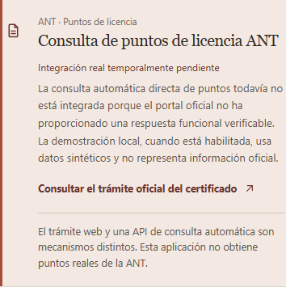
**Acceso de desarrollo a la demostración.** Con `VITE_ANT_DEMO=true` en Vite de desarrollo, Home ofrece accesos en el encabezado y en la sección ANT. La captura muestra esos accesos y mantiene separado el enlace al trámite oficial; no es parte de la interfaz de producción.

El resultado de estas medidas es que podemos probar el comportamiento de nuestra aplicación frente a fallos sin depender del portal externo. **El 502 de la ANT no está corregido en el servidor externo:** la integración real sigue pendiente de una respuesta funcional y de confirmar un mecanismo de consulta autorizado. Lo que sí resolvimos fue el manejo controlado de esa limitación dentro de nuestro sistema.

### Otro 502 que sí corregimos en el adaptador SRI

Durante las pruebas también apareció un error diferente. El servicio de detalles del contribuyente del SRI respondió correctamente con HTTP 200 y JSON, pero la estructura recibida fue un arreglo en la raíz. Nuestra primera implementación esperaba únicamente un objeto JSON y, al no reconocer el formato, generaba el error interno **502 PROVIDER_BAD_RESPONSE**.

Corregimos el adaptador para aceptar las dos estructuras respaldadas por las pruebas: un objeto raíz, observado en una consulta autorizada anterior, o un arreglo raíz, observado el 15 de noviembre de 2026. Cuando recibe un arreglo, selecciona un único registro cuyo número de RUC coincide exactamente con el solicitado. Si no encuentra coincidencia, hay varias o la estructura no es válida, mantiene el error técnico en lugar de afirmar que el contribuyente no existe.

Esta corrección se cubrió con fixtures y pruebas automatizadas. Es importante diferenciarla del problema ANT: en el caso SRI ajustamos nuestro código para interpretar correctamente una respuesta HTTP 200; en el caso ANT recibimos un HTTP 502 del portal externo y no obtuvimos una respuesta funcional que pudiéramos integrar.

El detalle de las pruebas, las rutas revisadas y sus limitaciones se encuentra en [Diagnóstico técnico de endpoints SRI y ANT](docs/integraciones/diagnostico-endpoints.md).

## 7. API REST del proyecto

La API está versionada bajo **/api/v1** y utiliza JSON.

| Método | Endpoint | Descripción | Estado |
|---|---|---|---|
| POST | /api/v1/contribuyentes/consultas | Valida el correo y el RUC; consulta existencia y detalles del contribuyente en SRI. | Implementado |
| POST | /api/v1/vehiculos/consultas | Consulta los datos del vehículo mediante la placa en SRI. | Implementado |
| POST | /api/v1/licencias/puntos/consultas | Permite probar el contrato normalizado de puntos con datos sintéticos. | Solo perfil local-simulation |
| GET | /actuator/health | Comprueba el estado de salud del backend. | Implementado |

Ejemplo de solicitud para consultar un contribuyente:

~~~json
{
  "email": "usuario@ejemplo.com",
  "ruc": "0000000000000"
}
~~~

Ejemplo de solicitud para consultar un vehículo:

~~~json
{
  "placa": "ABC1234"
}
~~~

Los valores anteriores son ejemplos sintéticos y no representan consultas reales. El contrato completo, las validaciones y los códigos de error se explican en [Contrato REST v1](docs/api/contrato-v1.md).

### Ejemplos sintéticos de respuesta

Los siguientes fragmentos reflejan el contrato REST documentado. Son fixtures sintéticos; no son cuerpos literales de respuestas personales del SRI.

Respuesta de contribuyente:

~~~json
{
  "data": {
    "ruc": "0000000000000",
    "tipoPersona": "NATURAL",
    "datosSRI": {
      "numeroRuc": "0000000000000",
      "tipoContribuyente": "PERSONA NATURAL"
    }
  },
  "meta": {
    "requestId": "550e8400-e29b-41d4-a716-446655440000",
    "source": "SRI",
    "retrievedAt": "2026-11-14T20:00:00Z"
  }
}
~~~

Respuesta vehicular:

~~~json
{
  "data": [
    {
      "camposSRI": {
        "codigoVehiculo": 123,
        "numeroPlaca": "E2E1234",
        "numeroCamvCpn": null,
        "aplicaCuota": true
      }
    }
  ],
  "meta": {
    "requestId": "550e8400-e29b-41d4-a716-446655440000",
    "source": "SRI",
    "retrievedAt": "2026-11-14T20:00:00Z"
  }
}
~~~

Los ejemplos distinguen texto, número, nulo y booleano. El backend conserva los campos observados que reconoce; una lista vehicular vacía no se transforma por sí sola en una afirmación de inexistencia.

### Vistas de formularios y resultados

**Formulario de contribuyente.** Se muestran los campos requeridos vacíos, los formatos esperados y la indicación de que el correo se valida en la aplicación.

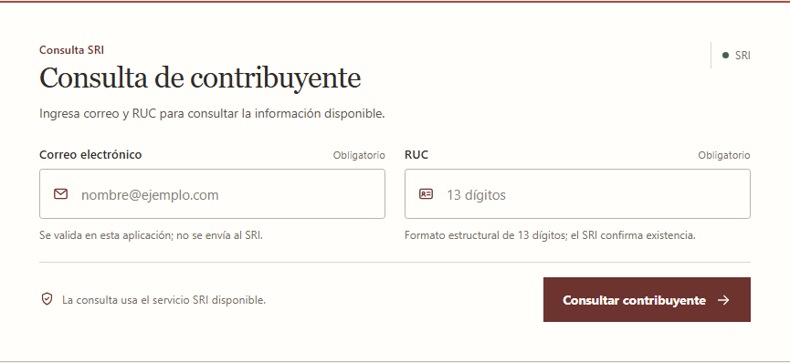

**Resultado de contribuyente.** La siguiente pantalla usa un fixture rotulado como sintético para ilustrar la clasificación y los grupos de datos; no contiene información de una consulta personal.

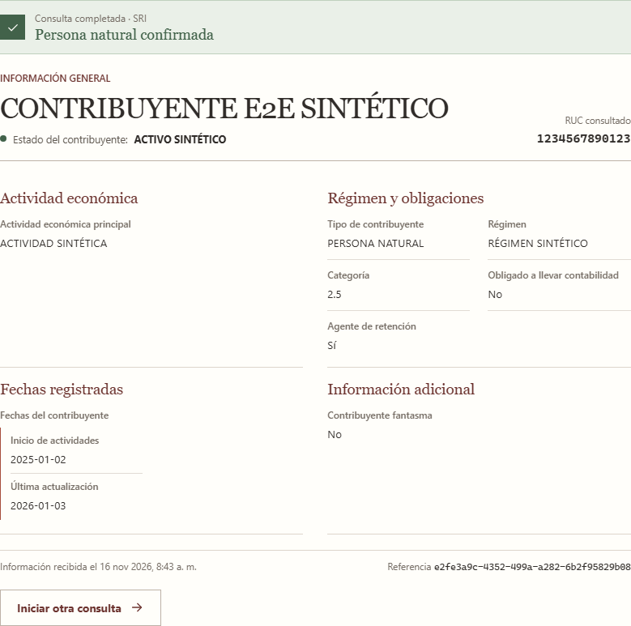

**Formulario vehicular.** Captura del ingreso de placa sin datos introducidos.

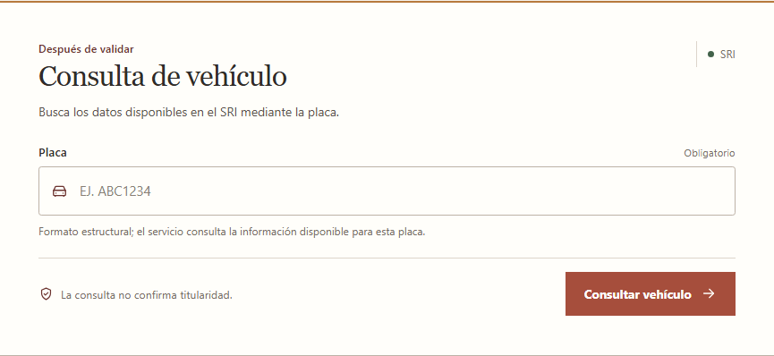

**Resultado vehicular.** La prueba presenta campos de un vehículo sintético y aclara que consultar una placa no confirma titularidad.

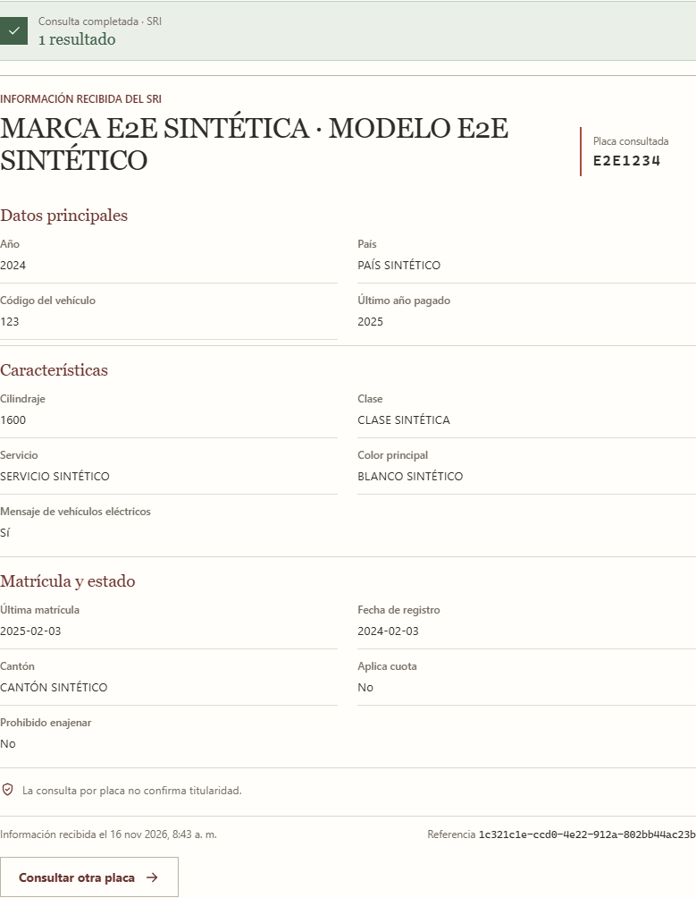

**Error controlado.** Esta captura ilustra el mensaje seguro que usa la interfaz para una respuesta no utilizable; corresponde a una prueba con stub local, no a una consulta en vivo.

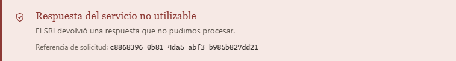

Las respuestas exitosas incluyen un objeto de datos y metadata con el **requestId**, la fuente y la fecha de obtención. En los errores se devuelve un código estable, un mensaje controlado y el mismo identificador de solicitud en el cuerpo y en el encabezado **X-Request-Id**. No se devuelven trazas ni cuerpos sensibles de los proveedores.

## 8. Tecnologías utilizadas

| Área | Tecnología | Uso en el proyecto |
|---|---|---|
| Interfaz | React y TypeScript | Construcción de la aplicación web y sus formularios. |
| Herramienta frontend | Vite | Desarrollo local y compilación de la interfaz. |
| Backend | Java 17 y Spring Boot 3.5.16 | API REST, validaciones y ejecución de los casos de uso. |
| Construcción backend | Maven Wrapper | Compilación, pruebas y generación del JAR. |
| Resiliencia | Resilience4j 2.4.0 | Circuit Breaker en la frontera del proveedor de puntos simulado. |
| Caché | Spring Data Redis | Adaptador de almacenamiento y recuperación de resultados de puntos. |
| Pruebas frontend | Vitest y React Testing Library | Pruebas de componentes y comportamiento de la interfaz. |
| Pruebas E2E | Playwright | Verificación de recorridos completos en Chromium. |
| Pruebas backend | JUnit, MockMvc y MockRestServiceServer | Pruebas de dominio, controladores y adaptadores HTTP. |
| Arquitectura | IcePanel | Modelado de los diagramas C4. |

## 9. Estructura del repositorio

~~~text
Consultas-SRI-ANT/
├── frontend/
│   ├── public/
│   │   └── images/
│   └── src/
│
├── backend/
│   ├── src/
│   │   ├── main/java/ec/edu/udla/consultas/
│   │   └── test/
│   ├── mvnw
│   └── pom.xml
│
├── docs/
│   ├── arquitectura/
│   │   └── mapeo-c4-codigo.md
│   ├── api/
│   │   └── contrato-v1.md
│   ├── integraciones/
│   │   └── diagnostico-endpoints.md
│   ├── pruebas/
│   │   ├── demo-ant-local.md
│   │   ├── backend-sri-api.md
│   │   ├── e2e-sri-frontend-backend.md
│   │   └── evidencias-ant-redis/
│   └── diseno/
│       ├── rediseño-ui-ux.md
│       └── recursos-visuales.md
│
└── scripts/
~~~

El backend organiza el código por módulos funcionales. Dentro de cada módulo se separan el dominio, los casos de uso y los adaptadores de entrada y salida. El [mapeo C4 a paquetes Java](docs/arquitectura/mapeo-c4-codigo.md) permite relacionar los componentes del diagrama con sus ubicaciones en el código.

## 10. Cómo ejecutar el proyecto localmente

### Requisitos previos

- **Java JDK 17.** Maven Wrapper está incluido en el backend, por lo que no hace falta instalar Maven globalmente.
- **Node.js 20.19 o superior, o 22.12 o superior.** El desarrollo y las verificaciones documentadas se realizaron con Node 24.18.0.
- **npm**, incluido con Node.js.
- Acceso a Internet para las consultas SRI durante el uso normal.
- Para las pruebas E2E, Chromium instalado mediante Playwright.
- Docker solo es necesario para las pruebas opcionales que utilizan Redis real.

No se necesita Redis ni ANT para iniciar el backend en su configuración predeterminada.

### 1. Iniciar el backend

Abre una terminal en la carpeta del proyecto y ejecuta:

~~~powershell
cd backend
.\mvnw.cmd -B clean verify
.\mvnw.cmd spring-boot:run
~~~

En Linux o macOS utiliza **./mvnw** en lugar de **.\mvnw.cmd**.

Por defecto, el backend queda disponible en el puerto **8080**. Puedes comprobar que inició correctamente con:

~~~powershell
Invoke-RestMethod -Uri http://localhost:8080/actuator/health -Method Get
~~~

La respuesta esperada es un estado de salud **UP**. Esta comprobación no consulta SRI, ANT ni Redis.

### 2. Iniciar el frontend

Abre una segunda terminal:

~~~powershell
cd frontend
npm install
npm run dev
~~~

Vite mostrará la dirección local de la aplicación, normalmente:

~~~text
http://localhost:5173
~~~

El proxy de Vite reenvía las solicitudes de **/api** al backend que se ejecuta en el puerto 8080. De esta forma, durante el desarrollo el navegador utiliza nuestra API y no se comunica directamente con los proveedores externos.

Para detener los procesos, utiliza **Ctrl + C** en las terminales donde se iniciaron.

### Configurar otra dirección del backend

Si el backend se ejecuta en otra dirección, copia **frontend/.env.example** a **frontend/.env.local** y configura **VITE_API_BASE_URL**. En el desarrollo local habitual no hace falta cambiar esta variable porque Vite ya utiliza el proxy configurado.

### Variables de entorno

En el uso normal no hace falta activar Redis ni la simulación ANT. Las variables de demostración se configuran solo en las terminales locales donde se inicia cada proceso.

| Variable | Uso |
|---|---|
| VITE_API_BASE_URL | Base opcional para el cliente web; por defecto usa /api/v1. |
| VITE_API_PROXY_TARGET | Destino del proxy de desarrollo; normalmente http://localhost:8080. |
| VITE_ANT_DEMO | Debe ser true para mostrar la entrada a la demo, y solo se habilita cuando Vite corre en desarrollo. |
| SPRING_PROFILES_ACTIVE | Use local-simulation para registrar el controlador y proveedor sintéticos de puntos, enlazados a loopback. |
| ANT_SIMULATION_SCENARIO | Selecciona el escenario sintético del backend; no es un parámetro HTTP. |
| REDIS_CACHE_ENABLED | Por defecto es false; habilítela únicamente para una prueba local preparada con Redis. |
| REDIS_HOST, REDIS_PORT, REDIS_CACHE_TTL | Conexión y expiración configurable cuando Redis está explícitamente habilitado. |
| REDIS_CACHE_HMAC_SECRET | Secreto local requerido al habilitar Redis; manténgalo fuera del repositorio y de los logs. |

Redis Cloud no está configurado en este proyecto.

## 11. Demostración local de puntos ANT

La demostración de puntos está separada del flujo normal de la aplicación. Para habilitarla se requiere activar explícitamente la variable **VITE_ANT_DEMO=true** en Vite y arrancar el backend con el perfil **local-simulation**.

Para abrirla, inicia el backend y el frontend en terminales distintas. Desde Home aparecen dos accesos, **Demostración ANT** en la navegación y **Simular consulta ANT** en la tarjeta, únicamente si Vite está en desarrollo y la variable está activada. El formulario admite solo el fixture sintético documentado y limpia el campo al enviar. Si activas o cambias `VITE_ANT_DEMO` con Vite ya iniciado, detén y reinicia Vite para que la nueva configuración surta efecto.

~~~powershell
# Terminal 1: backend local
cd backend
$env:SPRING_PROFILES_ACTIVE = 'local-simulation'
$env:ANT_SIMULATION_SCENARIO = 'SUCCESS'
.\mvnw.cmd spring-boot:run
~~~

~~~powershell
# Terminal 2: interfaz de desarrollo en loopback
cd frontend
$env:VITE_ANT_DEMO = 'true'
$env:VITE_API_PROXY_TARGET = 'http://127.0.0.1:8080'
npm run dev -- --host 127.0.0.1 --port 5173 --strictPort
~~~

La demo no se puede abrir ni se muestra en la interfaz del build de producción: la bandera de acceso depende del modo de desarrollo y de `VITE_ANT_DEMO=true`. Una revisión del bundle encontró que se conserva una etiqueta de botón condicional, aunque no se renderizan el acceso ni la vista. Para el recorrido local con Redis, consulta [Demo local de puntos ANT](docs/pruebas/demo-ant-local.md); no se debe activar en un servidor público.

El backend utiliza un identificador sintético fijo para las pruebas y queda enlazado a **127.0.0.1**. El simulador puede representar distintos escenarios:

| Escenario | Comportamiento |
|---|---|
| SUCCESS | Devuelve un total sintético de puntos. |
| ZERO | Devuelve cero como resultado presente, no como ausencia de información. |
| NO_DATA | Devuelve ausencia de información. |
| UNAVAILABLE | Simula indisponibilidad del proveedor. |
| TIMEOUT | Simula un timeout. |
| INVALID_RESPONSE | Simula una respuesta inválida. |
| RECOVERY | Simula una primera falla y una respuesta posterior exitosa. |
| SUCCESS_THEN_TIMEOUT | Guarda un resultado simulado y después provoca un timeout para probar la recuperación desde Redis. |

Cuando se utiliza el escenario **SUCCESS_THEN_TIMEOUT** con Redis local habilitado, la primera consulta devuelve **SIMULATED** y guarda el resultado en el espacio de claves de simulación. La siguiente consulta produce un timeout simulado y recupera el dato como **CACHE**, manteniendo **originSource=SIMULATED**, **stale=true** y la fecha original.

Ver captura de la demostración local

*Captura generada mediante Playwright con el proveedor simulado. No es una consulta real ni información oficial de la ANT.*

**Primer resultado local.** La captura E2E muestra la fuente SIMULATED, el total sintético y la advertencia de que no es información oficial. En este recorrido se ejecutó el simulador local con Redis 7.4 real en Docker por loopback.

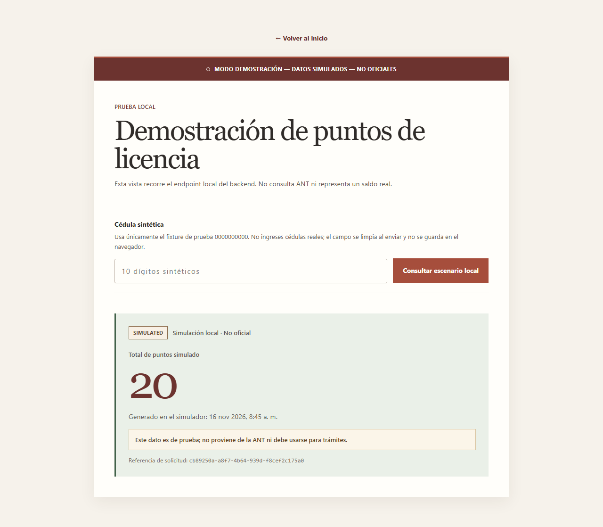

**Recuperación desde caché.** La segunda captura pertenece al mismo recorrido: tras un timeout producido por el simulador, la respuesta se marcó CACHE, conservó originSource=SIMULATED y la fecha fetchedAt original, y advirtió que el dato podía estar desactualizado. No demuestra una caída real de ANT.

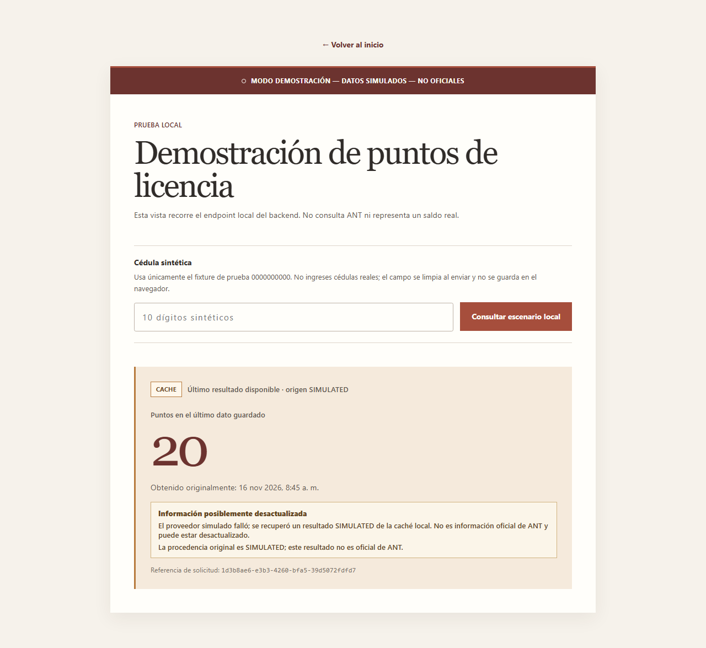

Los comandos completos, la configuración de Redis, los escenarios y las evidencias están en [Demostración local de puntos de licencia](docs/pruebas/demo-ant-local.md).

## 12. Pruebas y resultados

No consideramos suficiente que la aplicación compile. También probamos las validaciones, los errores de los proveedores, el flujo entre el navegador y el backend y el comportamiento de la caché ante un timeout.

En la repetición de cierre del **16 de noviembre de 2026, entre 08:39 y 08:45 (-05:00)** se obtuvieron los siguientes resultados:

| Verificación | Resultado | Qué comprueba |
|---|---:|---|
| Backend: Maven Wrapper clean verify | 165 pruebas aprobadas; 0 fallos, 0 errores y 0 omitidas. | Dominio, casos de uso, validaciones, controladores, adaptadores y arranque local. |
| Integración Redis JUnit | 2 pruebas aprobadas, ejecutadas por separado. | Lectura, escritura, TTL y recuperación del caso de uso contra Redis 7.4.12 real en Docker local. |
| Frontend: Vitest | 33 de 33 pruebas aprobadas. | Estados, validaciones, resultados y mensajes de la interfaz. |
| Frontend: lint | Aprobado. | Revisión estática del código frontend. |
| Frontend: build | Aprobado. | Compilación de TypeScript y generación de la aplicación Vite. |
| Playwright E2E SRI | 3 de 3 pruebas aprobadas. | Recorridos de contribuyente y vehículo y manejo de error con un stub SRI local. |
| Playwright ANT simulado | 7 de 7 pruebas aprobadas. | Estados de la demostración local de puntos. |
| Playwright ANT + Redis | 1 de 1 prueba aprobada. | Éxito simulado, timeout y recuperación desde Redis local real. |

**Alcance de estas pruebas:** los recorridos SRI utilizaron un servidor de prueba local; los recorridos ANT utilizaron el simulador de la aplicación. No se consultaron servicios SRI ni ANT reales durante esta ejecución. Las dos pruebas JUnit de Redis y la prueba Playwright ANT + Redis sí utilizaron Redis 7.4.12 real en un contenedor local, pero eso no significa que Redis Cloud esté conectado.

El detalle de esta repetición, sus logs sanitizados y capturas está en el [registro de verificación final](docs/pruebas/evidencias-final/20261116/README.md). Los resultados históricos se conservan en [Evidencias de pruebas ANT y Redis](docs/pruebas/evidencias-ant-redis/README.md). La explicación de los recorridos del navegador está en [Prueba integral E2E](docs/pruebas/e2e-sri-frontend-backend.md).

**Estado de error en navegador.** La imagen es una captura de Playwright con stub local y muestra el mensaje seguro y la referencia de solicitud, sin traza ni cuerpo externo.

### Verificación de cierre — 16 de noviembre de 2026

En esta ronda se volvieron a ejecutar las pruebas de backend y frontend. La suite ANT se ejecutó contra el simulador local activo, usando su misma configuración Playwright y sin generar otra copia de la galería de capturas.

| Verificación | Resultado de esta ronda |
|---|---:|
| Maven Wrapper `verify` | 165 pruebas aprobadas; 0 fallos, 0 errores y 0 omitidas. |
| Vitest | 35 de 35 pruebas aprobadas. |
| Lint | Aprobado. |
| Build de producción | Aprobado. |
| Playwright E2E SRI | 4 de 4 pruebas aprobadas con stub local. |
| Playwright ANT | 7 de 7 pruebas aprobadas con el simulador local. |

Estas pruebas no consultaron los servicios reales del SRI ni de la ANT. Las pruebas opcionales contra Redis 7.4 local se documentan por separado en la tabla histórica anterior; no se repitieron en esta ronda.

## 13. Seguridad y tratamiento de datos

Durante el desarrollo procuramos que las identificaciones y los datos de consulta no se expongan innecesariamente:

- El correo electrónico se valida, pero no se envía al SRI ni se almacena.
- El frontend mantiene los datos de entrada en memoria y no los guarda en localStorage, sessionStorage ni en la URL.
- Los errores no muestran trazas ni cuerpos completos de los servicios externos.
- El backend genera un requestId para facilitar el seguimiento de una solicitud sin registrar sus datos personales.
- Las claves Redis utilizan HMAC-SHA-256 para no incluir la cédula en texto plano.
- Los ejemplos y escenarios de simulación utilizan valores sintéticos. Para consultas reales deben utilizarse únicamente datos propios o con autorización.

## 14. Limitaciones y trabajo pendiente

El proyecto tiene una base funcional y pruebas reproducibles, pero todavía conserva límites que deben tenerse presentes:

1. **Integración real ANT:** no se ha implementado el cliente HTTP ni el parser del portal. Las rutas investigadas respondieron 502 y no se obtuvo una página funcional.
2. **Contrato ANT:** no se confirmó una API pública documentada para consulta automática, ni se verificó que la ruta de citaciones investigada corresponda al saldo de puntos. No se debe asumir que el trámite web oficial equivale a una API.
3. **Redis Cloud:** el adaptador está implementado y fue probado con Redis local, pero la instancia cloud no está configurada. Redis está desactivado por defecto.
4. **Clasificación de personas jurídicas en SRI:** está confirmada la equivalencia para PERSONA NATURAL; no se infiere una clasificación jurídica que no haya sido verificada.
5. **Titularidad vehicular:** consultar una placa devuelve información del vehículo, pero no comprueba su relación de propiedad con el contribuyente.
6. **Validación de identificaciones:** la validación local de RUC y cédula es estructural; no sustituye la verificación oficial de dígitos, existencia o titularidad.
7. **Despliegue:** las pruebas documentadas son locales. No se afirma que exista un despliegue productivo.

Para continuar con la integración ANT será necesario disponer de una respuesta funcional, verificar el flujo legítimo de consulta, confirmar sus parámetros y conocer un mecanismo autorizado de acceso. Solo entonces se podrá implementar y probar el adaptador real y definir una política de vigencia adecuada para los datos almacenados en caché.

## 15. Documentación y evidencias

Para revisar cada parte del desarrollo, estos son los documentos principales del repositorio:

| Documento | Contenido |
|---|---|
| [Arquitectura C4 en IcePanel](https://s.icepanel.io/n43YWpkfdsi2st/hsOQ) | Modelo editable de contexto, contenedores y componentes. |
| [Mapeo C4 a paquetes Java](docs/arquitectura/mapeo-c4-codigo.md) | Relación entre los componentes y las clases del backend. |
| [Contrato REST v1](docs/api/contrato-v1.md) | Endpoints, solicitudes, respuestas, validaciones y errores. |
| [Diagnóstico de endpoints](docs/integraciones/diagnostico-endpoints.md) | Investigación de SRI y ANT, respuestas observadas y limitaciones. |
| [README del backend](backend/README.md) | Configuración, ejecución, paquetes, Redis y pruebas del backend. |
| [README del frontend](frontend/README.md) | Ejecución, interfaz, variables y pruebas frontend. |
| [Demo local ANT](docs/pruebas/demo-ant-local.md) | Escenarios simulados y recuperación desde caché. |
| [Prueba E2E SRI](docs/pruebas/e2e-sri-frontend-backend.md) | Recorrido entre navegador, frontend, backend y stub SRI. |
| [Evidencias de pruebas](docs/pruebas/evidencias-ant-redis/README.md) | Resultados, reportes, logs y capturas de la ejecución del 16-11-2026. |
| [Prueba de usabilidad](docs/pruebas/guia-prueba-usabilidad.md) | Protocolo y plantilla vacía para una sesión real; no contiene resultados inventados. |
| [Matriz de rúbrica](docs/evaluacion/matriz-rubrica.md) | Evidencia por criterio, limitaciones y pendientes. |
| [Diseño de la interfaz](docs/diseno/rediseño-ui-ux.md) | Decisiones visuales y evidencias de la interfaz. |
| [Recursos visuales](docs/diseno/recursos-visuales.md) | Fuentes, autores y licencias de las fotografías utilizadas. |

## Mejoras recientes de experiencia de usuario (UX)

Los formularios ahora muestran su estado de validación mientras la persona escribe, una vez que ha interactuado con el campo. El correo se revisa localmente, el RUC se valida estructuralmente como trece dígitos ASCII y la placa conserva las reglas de formato existentes. Un indicador verde y un check circular señalan un formato válido; una X roja y un mensaje breve identifican el dato que debe corregirse. El botón de consulta permanece deshabilitado mientras haya campos obligatorios inválidos.

Estas señales permiten corregir errores antes de enviar la solicitud. La validación local del RUC solo comprueba su estructura: no confirma que exista. Esa confirmación corresponde al servicio del SRI y se realiza después de enviar una solicitud válida.

**Validación antes del envío.** La captura usa un correo de ejemplo con dominio reservado `.invalid` y un valor incompleto de prueba. Muestra un campo válido y otro inválido, sin enviar una consulta.

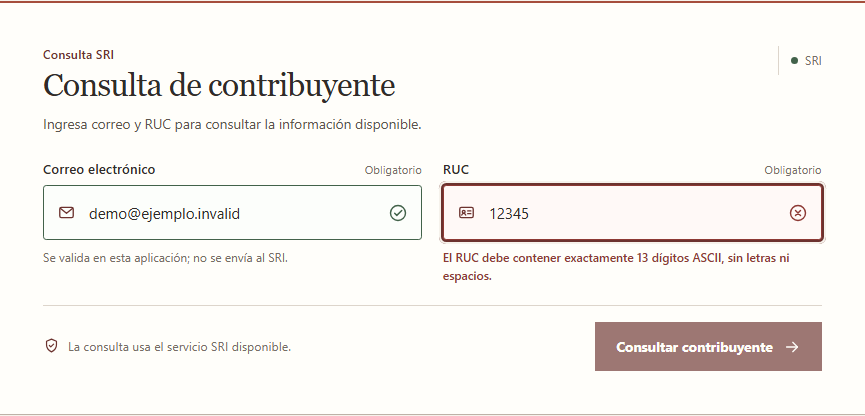

### Cambios incorporados recientemente

Además de la validación visual, se ampliaron las pruebas automatizadas para cubrir los estados iniciales, la corrección de los campos y los flujos SRI y ANT simulados. El runner de usabilidad aísla una copia temporal del JAR por sesión; así, una reconstrucción de Maven no modifica el archivo que está usando Spring Boot durante la prueba manual.

Las consultas SRI continúan probándose con un stub local. La ANT real sigue sin una respuesta funcional verificada; su demostración, cuando se activa en desarrollo, presenta datos `SIMULATED` y no información oficial. La recuperación `CACHE` se ha demostrado con el simulador y Redis local, no ante una caída real de ANT. La guía de usabilidad está preparada, pero todavía no se ha realizado una sesión con una persona participante ni se han registrado tiempos u observaciones.

---

## Conclusión

Con este proyecto construimos una aplicación web que integra las consultas SRI de contribuyentes y vehículos, organiza el backend mediante responsabilidades separadas y documenta una estrategia para manejar fallos de servicios externos. La arquitectura modular con enfoque hexagonal nos permitió probar los casos de uso sin depender directamente de los proveedores y mantener aislados los detalles de infraestructura.

La integración ANT fue el principal inconveniente técnico. Aunque no pudimos completar una consulta real de puntos debido a las respuestas 502 del portal, investigamos el problema, comprobamos las rutas disponibles y evitamos presentar datos simulados como información oficial. Además, implementamos y probamos el contrato local, el Circuit Breaker y la recuperación desde Redis para dejar preparado ese comportamiento sin afirmar que la conexión externa ya funciona.

El resultado es una solución cuyo alcance, decisiones, pruebas y limitaciones se pueden revisar tanto en el código como en los diagramas C4 y en las evidencias publicadas en este repositorio.
